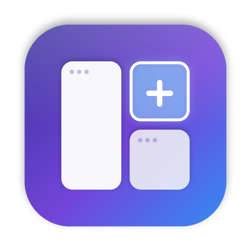

<table><tr><td align="center" width="9999">

# MAWIO

**Drag-to-tile window manager for macOS — one layout per desktop, remembered forever.**

Hold <kbd>⇧</kbd> while dragging a window and drop it where it belongs. MAWIO splits, swaps and resizes your
windows, gives every Mission Control desktop its own layout, name and color, and brings everything back after a restart.

### [Download the latest version](../../releases/latest)

</td></tr></table>

---

## Features

### Tiling by dragging
- **⇧ + drag** any window to see the desktop's tiles. Drop near an edge to **split**, in the center to **swap** or
  **replace**, on an empty desktop to **fill** it.
- A live preview shows the dragged app's icon, what will happen (*"Right of Safari"*, *"Swap with Mail"*) and where
  the other window will go.
- Splits nest as deep as you like. Drag a tiled window away without ⇧ to untile it — its neighbour fills the gap.

### Resizable layouts
- Every gap is a **divider**: drag it to resize everything on both sides at once.
- Dividers **snap** to ⅓, ½ and ⅔ and show the current ratio while you drag. **Double-click** to reset to 50 : 50.

### Desktops with personality
- Each Mission Control desktop gets its own layout, plus a **name, color and icon**.
- A slim **toolbar** above the tiles shows the desktop and its apps; click an app to focus it.
- **Add App** — pick any installed app, click where it should go, and MAWIO opens and tiles it.
- Save arrangements as **named layouts** and load them onto any desktop.

### Always restored
- Every change is saved automatically. After relaunching MAWIO — or your Mac — windows return to their tiles, even
  when an app has several windows.
- Layouts adapt automatically when you connect or disconnect a display or change resolution.

### Overview & focus stats
- The menu bar badge shows the current desktop. Click it for an **overview of all desktops** with live mini-maps —
  click one to jump there.
- See **today's focus time** per app and per desktop.

---

## Installation

1. Download **`MAWIO-<version>.dmg`** from the [latest release](../../releases/latest).
2. Open it and drag **MAWIO** into **Applications**.
3. Launch MAWIO from Applications. A short welcome guide walks you through setup.
4. When asked, allow **Accessibility** access (System Settings → Privacy & Security → Accessibility).
   MAWIO needs it to move and resize windows.

MAWIO is signed with an Apple Developer ID and notarized by Apple, so it opens without security warnings.

**Recommended macOS settings** (System Settings → Desktop & Dock):
- Turn off *Automatically rearrange Spaces based on most recent use* so desktops keep their order.
- Turn off *Drag windows to screen edges to tile* and keep Stage Manager off to avoid conflicts.

### Updating
Download the new version and replace the app in Applications. Your layouts, desktop names and settings are kept.

### Uninstalling
Quit MAWIO from its menu bar panel and move it from Applications to the Bin. To also remove its settings, run
`defaults delete com.jakubbajzath.MAWIO` in Terminal.

---

## Usage

| Action | How |
| --- | --- |
| Tile a window | Start dragging by the title bar, hold <kbd>⇧</kbd>, drop on a zone |
| Split a tile | Drop near its left / right / top / bottom edge |
| Swap or replace | Drop in the center of a tile |
| Untile | Drag a tiled window away without <kbd>⇧</kbd>, close or minimize it |
| Resize | Drag a divider (snaps to ⅓ · ½ · ⅔) |
| Reset a split | Double-click its divider |
| Rename / recolor a desktop | Click its name in the toolbar |
| Open an app into a tile | Toolbar → <kbd>+</kbd> → pick app → click a position |
| Save / load a layout | Toolbar → layouts button, or the menu bar overview |
| Jump to a desktop | Menu bar badge → click a desktop card |

---

## Privacy

MAWIO works entirely on your Mac. It has no accounts, no analytics and makes no network requests.
Accessibility access is used only to move and resize windows — MAWIO never reads what's inside them.
Layouts and focus stats are stored locally in MAWIO's preferences.

---

## Requirements & limitations

- macOS 14 Sonoma or newer.
- **Fullscreen apps** (green button) live on their own Space and can't be tiled — use normal desktops instead.
- macOS doesn't let other apps change a window's corner radius or hide its title bar buttons.
- Some apps enforce a minimum window size and may overlap a neighbour in very small tiles.

---

## Feedback

Found a bug or have an idea? [Open an issue](../../issues).

MAWIO is free to download and use. The source code is not public.
